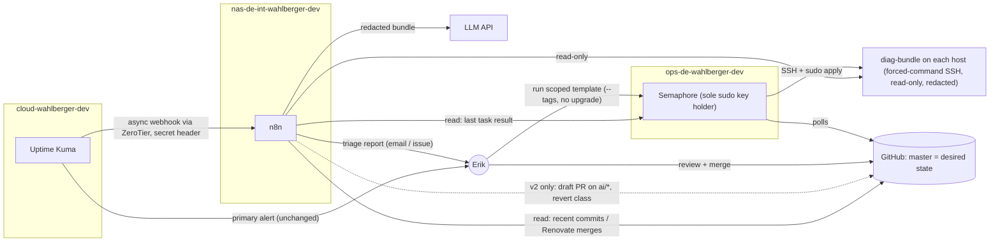

## Decision: AI-assisted incident pipeline (Uptime Kuma -> n8n -> GitHub -> Semaphore)          date: 2026-09-27   status: proposed

### Context
Proposed loop: Uptime Kuma alert -> webhook -> n8n LLM agent investigates -> if the root cause is in a
playbook/role, the agent opens a GitHub PR -> human merges -> Semaphore re-runs the playbook.

Current state (verified in this repo):
- Uptime Kuma runs on `cloud-wahlberger-dev` (Hetzner) and reaches `nas`/`pi` over ZeroTier (`roles/zerotier`).
  `nas` has no public inbound port, so a webhook to n8n on the NAS travels cloud -> ZeroTier -> NAS Caddy. No port forward is needed.
- Semaphore on `ops-de-wahlberger-dev` (Hetzner VM, ZeroTier-only UI) is the only holder of the automation SSH key, which has passwordless sudo on all three hosts.
  Semaphore polls GitHub; there is no inbound webhook.
- `master` has **no branch protection and no rulesets** (checked with `gh api`, which returned 404 and `[]`).
- Renovate **auto-merges** minor/patch container bumps once CI passes (`renovate.json`). CI only runs lint, syntax and vault checks. It never applies anything.
- `common_upgrade: true` in all three `common` roles, so every full `site.yml` run also does a full zypper/apt upgrade.
- Two recent real incidents were caused by playbook problems:
  - 2026-09-19: the `/etc/hosts` 127.0.1.1 entry got copied into containers.
  - 2026-09-26: a Semaphore run's `zypper dup` reset `ip_forward`, and every published port on the NAS hung.

  In neither case were the logs the evidence. Containers showed "Up", firewalld and DNS looked fine, and the cause only showed up through hands-on tests (curl from another subnet, a `sysctl` read).

### Options considered
1. **Do nothing (Uptime Kuma alerts a human, who triages interactively).**
   Pros: no new attack surface. The interactive session can run the active experiments that actually solved the last two incidents.
   Cons: triage starts cold, and nothing collects host state at the moment of failure.
2. **v1: read-only AI triage.** Uptime Kuma keeps alerting the human directly. It also webhooks n8n, which collects a fixed
   diagnostic bundle, recent commits/Renovate merges and the last Semaphore task result, then asks an LLM for a triage
   report (cause class, evidence, suggested next check). n8n emails the report or files it as a GitHub issue. n8n has no write access to code or hosts.
   Pros: most of the value (context at failure time, "what changed recently") with a small blast radius. Wrong answers cost nothing.
   Cons: new service plus credentials. An LLM can still mislead a tired human.
3. **v2: option 2 plus draft PRs for one narrow class only.** Example: revert a Renovate bump that was merged and deployed shortly before the alert.
   Pros: mechanical, easy to verify, and it targets the most likely playbook-rooted outage source (unreviewed automerges).
   Cons: needs the full guardrail set below.
4. **Full vision: free-form fix PRs plus merge-triggered auto-apply.**
   Pros: the fewest human steps.
   Cons: LLMs are weakest at exactly the problems that happened here (root cause not visible in logs). There is a prompt-injection path from logs to infra-as-code.
   Without branch protection a bot token can push to `master` directly. A full `site.yml` "fix" run drags in OS upgrades, which caused the 09-26 outage.
   Container restarts re-fire alerts and create loops. The pipeline also dies with the thing it is supposed to fix (see risks).

### Chosen approach
**Build option 2 as v1 only if you are adopting n8n anyway. Do not adopt n8n just for this.** Consider option 3 only after v1 has run
long enough that you can compare its triage reports with the root causes you actually found. Reject option 4.
The core value is the diagnostic bundle plus "what changed recently" correlation. The LLM summary is optional on top, and code generation is the least valuable and most dangerous step.

Two prerequisites are worth doing even if no AI is ever built:
- Protect `master`: require a PR and green CI, and allow no direct pushes.
- Add a scoped "remediation" Semaphore template that runs `--tags <role>` with `-e common_upgrade=false`, so a fix never drags in unrelated OS upgrades.

### Contract / ownership
- Single writer to hosts: **Semaphore only**, unchanged. n8n never gets the automation key, the vault password or any Semaphore apply capability.
- Desired state: GitHub `master` is the single source of truth. A human merge is the only way code changes land. Renovate automerge is a conscious, separate exception.
- Monitor state: Uptime Kuma owns it.
- Diagnostic surface: each host owns a `diag-bundle` script deployed by Ansible and reviewed in git. It runs fixed read-only commands (`systemctl status`, `journalctl -u <unit> -n N`, `podman ps/logs`, key sysctls) and redacts secrets on the host.
  - n8n reaches it with a dedicated SSH key restricted in `authorized_keys` (`restrict,command="…/diag-bundle"`).
  - The only argument n8n can pass is a unit name, checked against an allowlist.
- Communication:
  - Uptime Kuma -> n8n: **async webhook, best effort** with a shared-secret header. This is fine because the direct human alert stays the primary path, so losing a webhook is tolerable. The Caddy site for n8n must exempt the webhook path from the Pocket ID gate.
  - n8n -> hosts, GitHub (read), Semaphore (read): sync request/response, all read-only.
  - GitHub -> Semaphore: polling, as today. No inbound webhook.
- v2 only: a GitHub App on this one repo with Contents and Pull requests write.
  - **No Workflows permission.** GitHub then rejects pushes that change `.github/workflows`.
  - A ruleset allows only `ai/*` branches and draft PRs.
  - A CI path guard fails any `ai/*` PR that touches `vault.yml`, `.github/`, `ssh_authorized_keys`, `security` or `firewall`, or that goes over a small diff budget.
  - At most one open AI PR per role.
  - Applying stays a manual run of the scoped template, not merge-triggered.

### Diagram

### Trade-offs / consequences
- The v1 agent can never fix anything, and that is deliberate. Its job is to cut time-to-context, not time-to-fix.
- Merge-then-apply is sound GitOps only if the merge is a real review. Reviewing an AI PR in the middle of an outage invites
  rubber-stamping, so applying stays a separate, deliberate step.
- If you ever make Semaphore apply on every `master` change, Renovate automerges will deploy with no human involved. Decide that on its own merits, not as a side effect of this pipeline.
- New surface: n8n (webhook ingress, LLM credentials, SSH diag key, GitHub token) on the NAS, which also holds your personal data.
  The pi is ruled out because it holds the master keys. Cloud is ruled out because a public host would then hold credentials into the home network. Both follow the same reasoning as the pi README.

### Open risks
- **Shared fate.** n8n on the NAS is unreachable in exactly the failures that matter most. In the 09-26 ip_forward incident, every published port on the NAS hung, and n8n sits behind Caddy on the NAS.
  In the 09-19 incident Semaphore could not SSH, so the apply leg was dead too. Pocket ID lives on cloud, so a cloud outage means no alerts and no OIDC logins.
  This is why the direct human alert must stay primary.
- **Wrong-class alerts.** Most "down" alerts will be host, network, ZeroTier, disk, Cloudflare/cert or upstream bugs, not playbook bugs.
  The agent also cannot see vault values, so its space of fixes is narrower than it looks.
- **Prompt injection.** Logs contain strings from outside, for example filenames on the guest Samba share that Paperless ingests.
  Enforce limits in tooling (read-only tools, CI path guard), never in the prompt.
- **Secret leakage** to a third-party LLM through logs. This repo already had a secret-logging audit fix (610feda). Redact on the host, inside `diag-bundle`.
- **Loops and cost.** Container restarts from handlers re-fire monitors. Mitigations: a per-monitor cooldown in n8n, ignoring alerts during or shortly after a Semaphore task, and retries on the Uptime Kuma side.
- **Assumptions to verify:** which LLM you use (cloud API or local), whether your n8n edition supports OIDC (otherwise put it behind oauth2-proxy the way `uptime_kuma` is), whether your Uptime Kuma version supports custom webhook headers, and which Semaphore role can read task output without being able to run tasks.
