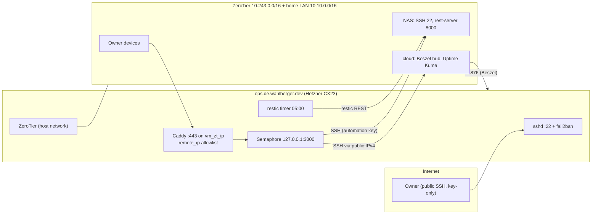

# ops-de-wahlberger-dev

Ansible playbook for **`ops.de.wahlberger.dev`**, a Hetzner Cloud CX23 (x86_64)
running **openSUSE Tumbleweed**. It hosts **Semaphore UI**, which applies the
`nas-de-int-wahlberger-dev`, `cloud-wahlberger-dev` and this playbook. The
Semaphore UI (and every other service) is reachable over **ZeroTier only**.
The one thing open to the internet is **TCP 22, key-only**.

This README is also the **operator runbook** for moving Semaphore from the Pi
(`pi-de-int-wahlberger-dev`) to this VM and retiring the Pi. The requirements
are in [`../semaphore-migration/reqs/semaphore-to-hetzner.md`](../semaphore-migration/reqs/semaphore-to-hetzner.md)
(IDs `SH-...`), the plan in [`../semaphore-migration/PLAN.md`](../semaphore-migration/PLAN.md)
(`T-nn` repository tasks, `OP-nn` operator items). Role details are in each
`roles/<role>/README.md`; conventions for editing this playbook are in
[`CLAUDE.md`](CLAUDE.md).

Built from the conventions of [`nas-de-int-wahlberger-dev`](../nas-de-int-wahlberger-dev)
(roles are copied per playbook, not shared).

## Why a separate VM

- No additional always-on device at home (the NAS was bought to lower electricity use).
- The NAS holds personal data and must not also hold the master SSH key and the Vault passwords.
- On the NAS, Semaphore would kill its own runner during NAS OS upgrades. On a separate VM this is limited to the VM's own playbook (the self-run, see "Self-run rules").

**Accepted risk (SH-R-01).** This host holds root-equivalent access to every
other host *and* exposes TCP 22 to the internet. Public SSH is kept on purpose
as the repair path when ZeroTier is down. If this VM is compromised, the
automation key, every playbook's Vault password, `access_key_encryption` and
the secrets rendered on the VM are exposed. See "Incident note".

## Names and values

| Term | Value |
|---|---|
| `<vm-dir>` | `ops-de-wahlberger-dev` (this directory) |
| `<vm-fqdn>` | `ops.de.wahlberger.dev`: public A record (`<vm-public-ip>`), inventory host, used for SSH |
| `<vm-zt-name>` | `ops.de.int.wahlberger.dev`: A record `<vm-zt-ip>`; target of the `semaphore` CNAME |
| `<vm-zt-ip>` | the VM's fixed ZeroTier IP (`vm_zt_ip` in `vars.yml`, empty until pull request A2) |
| `<zt-iface>` | the ZeroTier interface name (`vm_zt_iface`, empty until pull request A2) |
| `<cloud-zt-ip>` | cloud-wahlberger-dev's ZeroTier IP (`cloud_zt_ip`, see step 3) |
| `<sem-subnet>` | `semaphore_network_subnet` (`172.29.30.0/24`) |
| `<vm>` / `<vm-fw>` | Hetzner server `ops-de-wahlberger-dev` / Cloud Firewall `ops-de-wahlberger-dev-fw` |
| `<vm-user>` | `ops`: htpasswd user and repository name on the NAS rest-server |
| ZeroTier network | `8056c2e21cc5c789` (10.243.0.0/16); home LAN 10.10.0.0/16 |
| Service URL | `https://semaphore.de.int.wahlberger.dev` (unchanged; CNAME moves in step 8) |

## Layout

```text
ops-de-wahlberger-dev/
├── ansible.cfg                  # project-local Ansible settings
├── site.yml                     # entry point: exactly 14 roles, each tagged with its name
├── requirements.yml             # Galaxy collections
├── .ansible-lint / .yamllint    # lint config (production profile)
├── .vault_pass.sh               # reads the Vault password from 1Password
├── README.md / CLAUDE.md        # runbook / conventions for AI agents
├── docs/
│   ├── zerotier-flow-rules.md   # dated "before" and "in force" ZeroTier flow rules
│   ├── spikes/                  # measured facts (Semaphore image, authorized_keys from=, Caddy options)
│   └── security-review.md       # written by the security review (T-18)
├── inventories/production/
│   ├── hosts.yml                # one host: ops.de.wahlberger.dev (no ansible_host)
│   └── group_vars/all/          # vars.yml, vault.yml (encrypted), vault.yml.example
├── molecule/default/            # common, notify_failure, disk_space, ssh_authorized_keys, security
├── tests/                       # static-checks.sh, pr-boundaries.sh, render-check.sh, guard-tests.sh, guards.d/, render.d/, unit/, tools/
├── tools/                       # operator tooling for steps 4 and 6 (see tools/README.md)
└── roles/                       # common, notify_failure, disk_space, ssh_authorized_keys, security,
                                 # reboot_notify, firewall, podman, zerotier, beszel_agent,
                                 # cloudflare_dns, caddy, semaphore, restic_backup; container (helper)
```

## Architecture



Primary design: Caddy uses host networking and binds to `vm_zt_ip`; Semaphore is
published on `127.0.0.1:3000`. The bridge fallback (selected by `vm_proxy_design`)
puts both containers on `caddy.network`. See "Bridge fallback" and
[`roles/caddy/README.md`](roles/caddy/README.md).

## Prerequisites

- Workstation with the repository, **ansible-core 2.16** (pyenv venv), `op` (1Password CLI), `hcloud`, `sqlite3`, `restic`, `dig`, `nmap`, `nc`.
- 1Password item `Ansible Vault - ops-de-wahlberger-dev` (password) exists (OP-00a) and 1Password is unlocked for any local run.
- Galaxy collections: `ansible-galaxy collection install -r requirements.yml`.
- A Hetzner account and a ZeroTier Central account, both with two-factor authentication (step 0).

## Usage

Rule for **every** apply in this document: run `--check --diff` first, read the
output, then apply. A step whose `--check` output is unexplained does not
proceed (SH-BR-12).

```sh
cd ops-de-wahlberger-dev

# Dry run, then apply (everything).
ansible-playbook site.yml --check --diff
ansible-playbook site.yml

# Only one role.
ansible-playbook site.yml --check --diff --tags caddy
ansible-playbook site.yml --tags caddy
```

`inventories/production/hosts.yml` sets no `ansible_host` (SH-D-17). From the
workstation, a run without `-e ansible_host=...` connects to the **public** name
`ops.de.wahlberger.dev` and therefore sends the public-login email
(SH-FR-125). Pass `-e ansible_host=ops.de.int.wahlberger.dev` (over ZeroTier)
for workstation runs, or `-e ansible_host=<vm-public-ip>` during bootstrap
(step 2). Semaphore's self-run connects to `ops.de.wahlberger.dev`, which the
host delivers locally.

The Vault password comes from 1Password via `.vault_pass.sh` (`ansible.cfg`).
Semaphore supplies its own from the Key Store.

`--check` on a fresh host is only partly meaningful: roles tolerate "unit not
found" and similar misses that exist only because an earlier task merely
simulated a change (see `roles/security/README.md`), and the whole role set now
passes it end to end on the fixture (`tests/vm/RESULTS.md`, 2026-10-11). But
check mode cannot validate everything: the `firewall` role **skips** the three
ZeroTier-zone tasks (services, Beszel rich rule, interface binding) because the
zone does not exist yet (`roles/firewall/README.md`, "`--check --diff` on a fresh
host"), and the `cloudflare_dns` check calls the real Cloudflare API. Expect to
read `--check` output critically in step 2: a clean first `--check` is not proof
that those tasks work; the first real run is.

### Roles a self-run excludes: the workstation command

The `<vm-dir>` Semaphore template passes `--skip-tags semaphore,zerotier` and
`-e common_upgrade=false` (SH-FR-149, SH-FR-150), so a self-run never restarts
`semaphore.service` or `zerotier.service` and never upgrades OS packages. Apply
those roles from the workstation:

```sh
ansible-playbook site.yml --check --diff --tags semaphore,zerotier -e ansible_host=ops.de.int.wahlberger.dev
ansible-playbook site.yml --tags semaphore,zerotier -e ansible_host=ops.de.int.wahlberger.dev
```

**A change to `semaphore_image` (or any other file of the `semaphore` role)
takes effect only through this command**, never through a self-run. The same
holds for ZeroTier. A full OS upgrade (`common_upgrade` left at its default
`true`) happens only in a workstation run; the weekly `zypper-dup` timer is the
normal update path.

## Self-run rules

A self-run is a task of the `<vm-dir>` template started by this VM's own
Semaphore. What keeps it from cutting its own branch (SH-FR-66 to SH-FR-69,
SH-FR-188, SH-FR-189, SH-FR-214):

- `semaphore` and `zerotier` are skipped by the template (`--skip-tags semaphore,zerotier`).
- `common_upgrade=false`: no package upgrade.
- sshd configuration changes are **reloaded**, never restarted (`roles/security`).
- firewalld rules are applied permanent plus immediate, firewalld is never reloaded or restarted by a role (`roles/firewall`).
- the update script never reboots (it only asks rebootmgr; see "Updates and reboots").
- every self-run task must end within 60 min (SH-FR-69); no Semaphore schedule starts between 03:00 and 05:30 Europe/Berlin (SH-BR-07).

The self-run is checked by SH-AC-26 (step 7).

## Cloud Firewall (Hetzner)

Managed by hand (SH-D-15, SH-FR-03, SH-FR-04, SH-FR-133). It is attached **at
server creation**, so there is no unprotected moment at the network level.

| Direction | Protocol | Port | Source | Purpose |
|---|---|---|---|---|
| inbound | TCP | 22 | `0.0.0.0/0` | public SSH, key-only (the only inbound rule) |
| inbound | ICMP | none | none | no rule: ping from the internet is dropped |
| inbound | UDP | 9993 (ZeroTier) | none | no rule: ZeroTier uses outbound connections only |
| outbound | all | all | all | unrestricted |

`hcloud` commands (create before the server; verify the flags with
`hcloud <command> --help` before first use, they were not run by the author of
this document, TODO: verify):

```sh
hcloud firewall create --name ops-de-wahlberger-dev-fw
hcloud firewall add-rule ops-de-wahlberger-dev-fw \
  --direction in --protocol tcp --port 22 --source-ips 0.0.0.0/0 \
  --description "public ssh, key-only"
hcloud firewall describe ops-de-wahlberger-dev-fw      # exactly one inbound rule

# After the server exists (SH-AC-02):
hcloud server describe ops-de-wahlberger-dev            # type cx23, IPv4 only
hcloud server ip ops-de-wahlberger-dev                  # <vm-public-ip>
```

The host firewall (firewalld, `roles/firewall`) is a second layer: public zone
`ssh` only. If the Cloud Firewall is detached or gains a rule, the host still
accepts only TCP 22 on the public interface (SH-E-10); the SH-AC-03 scan shows
the drift.

## ZeroTier and flow rules

- The `zerotier` role (copied from cloud) joins network `8056c2e21cc5c789` as a Quadlet with host networking. The identity directory is persisted; it is **not** backed up (SH-D-19, SH-FR-171).
- Membership is manual: authorize the member in [ZeroTier Central](https://my.zerotier.com/) and give it a **fixed** IP. No Central API token exists in the repository (SH-FR-205).
- Flow rules are written by hand in Central's Flow Rules editor (SH-FR-132), in Central's rules language: <https://docs.zerotier.com/rules/> (TODO: verify URL). The allow matrix they implement is in [`docs/zerotier-flow-rules.md`](docs/zerotier-flow-rules.md), together with the dated "before" and "in force" rule sets (SH-FR-33, SH-FR-34). Rules affect only traffic to or from `<vm-zt-ip>`.
- `vm_zt_iface` is read on the VM with `ip -br link`. The `firewall` role binds that interface **by name** to zone `zerotier` in firewalld's permanent configuration, so the binding applies when the interface appears after firewalld started (SH-FR-185).

## Runbook

Each step has a **gate** (scenario ids from the amended step-gate table; a
scenario is described in the spec under its `SH-AC-nn`) that must hold before
the next step starts (SH-BR-12), and a **rollback**. Operator items `OP-nn` are
the matching checklist entries in the plan. Nothing in `pi-de-int-wahlberger-dev/`
is committed to until step 7 ends (SH-FR-97), and the Pi is only read from, apart
from one stop/start of `semaphore.service` per database copy of at most 10 min
(SH-FR-200).

### Pull requests ("merge is deploy")

Until step 8 the Pi's Semaphore can apply `master` to nas and cloud at any time
after a merge, so every pull request merged before step 8 is safe to apply at any
moment (SH-BR-16). Erik merges; `tests/pr-boundaries.sh <PR>` checks the file
boundary of a branch.

| PR | Merged in step | Content | Applied by | Why it is safe to apply early |
|---|---|---|---|---|
| A | 0 | this directory with empty `vm_zt_ip`; `ssh_authorized_keys_revoked` (empty) and the both-lists check in nas, cloud and `<vm-dir>`; cloud `restic_backup` host default; Renovate rules (SH-FR-160, SH-FR-161); "before" flow-rule record | workstation (VM); Pi or workstation (nas, cloud) | an empty revoked list and an unchanged effective backup host change nothing on nas and cloud |
| A2 | 3 (start) | `vm_zt_ip`, `vm_zt_iface`, `cloud_zt_ip` (read from ZeroTier Central at OP-02), "in force" flow-rule record | workstation | only `<vm-dir>` changes, which the Pi does not apply |
| A3 | 3 (end, after the step-3 tests, before step 4) | `vm_proxy_design` as decided, `semaphore_uid`, README observations (SH-FR-221) | workstation | only `<vm-dir>` and its README change |
| B | 5 | NAS client `ops` and its Vault keys | workstation or Pi | adds one htpasswd line; nothing uses it until the VM's backup runs |
| B2 | 5, after the first VM backup | NAS maintenance list (SH-CC-01), freshness path | workstation or Pi | the `ops` repository already exists, so maintenance does not fail (SH-E-18) |
| C | 6 (draft from step 4) | new key with `from=` in nas, cloud and `<vm-dir>`; migration notes in its description | workstation | adds a key usable only from the VM's addresses |
| C2 | 6, only if SH-FR-191 finds another source address | that address added to the new key's `from=` list in all three | workstation | widens `from=` by one address |
| C-R | 6, only on a step-6 rollback | new key moved to `ssh_authorized_keys_revoked` in nas, cloud and `<vm-dir>` | workstation | removes a key that nothing uses after the rollback |
| D | 8 | `semaphore_dns_cutover_enabled: true`; step-8 documentation; Renovate rule for `<vm-dir>` removed; NAS homepage group label | workstation (`<vm-dir>`, NAS `--tags homepage`); Pi (NAS) until stopped | the NAS change is a cosmetic label; the link URL is unchanged |
| E | 9.4 | old key revoked in nas and cloud; `pi-de-int-wahlberger-dev/` removed; documentation; Renovate rule for the Pi removed | workstation | runs after the point of no return, so no rollback depends on it |

BR-02 and BR-13 preconditions, used by several steps:

- **SH-BR-02**: a step-7 task against a host starts only when no Pi schedule that targets that host is due within the next 60 min.
- **SH-BR-13**: the Pi's `semaphore.service` is stopped (step 4 and step 8) only when no Pi task is running and no Pi schedule is due within the next 60 min. Otherwise the stop waits (SH-E-37).
- **SH-BR-14**: from the step-4 record until step 8 no configuration object in the Pi's Semaphore changes (task runs are allowed). If a change is unavoidable before step 6, repeat step 4 (SH-BR-03). After step 6 has started, make the same change on the VM and record both in the PR D description.
- **SH-BR-03**: the Pi database is copied to the VM only before step 6 starts, and never after step 8.
- **SH-BR-08**: the old key is revoked in step 9.4 only.

### Step 0 - Prepare (OP-00a, OP-00b, OP-00c)

1. Create the 1Password item `Ansible Vault - ops-de-wahlberger-dev` (OP-00a). Build the VM's `vault.yml` once with `tools/populate-vault.sh` (seven values copied from the Pi's Vault, two generated); see [`tools/README.md`](tools/README.md). Check the carried-over values with `tools/vault-hash-compare.sh` (SH-AC-17).
2. Checks: personal key protection (SH-FR-163), Hetzner 2FA (SH-FR-164), Central 2FA (SH-FR-165), and the SHA-256 of the Pi's live `config.json` `access_key_encryption` against the Pi Vault's `vault_semaphore_access_key_encryption` (SH-FR-180). Compare hashes only; never print the values.
3. Generate the new automation key on the workstation (SH-FR-56) and hand the **public** half to the pull request C branch. See "New automation key".
4. Save Central's current rule set into `docs/zerotier-flow-rules.md`, section "Before" (SH-FR-33). The text is filled in by the PR A packaging task from your input.
5. Record the step-0 baseline in the PR A description (SH-FR-213): every Beszel system and every Uptime Kuma monitor that is up, with date and time.
6. Read, do not change, the Pi facts (SH-FR-200), including the Pi image tag (`podman inspect --format '{{.ImageName}}' semaphore`).
7. Merge pull request A.

**Gate:** SH-AC-01, SH-AC-17, SH-AC-27, SH-AC-30, SH-AC-44, SH-AC-45, SH-AC-52, SH-AC-56, SH-AC-59, SH-AC-60, SH-AC-65, SH-AC-66. The `[S]` ones run with `tests/static-checks.sh` (see "Tests").

**Rollback:** revert pull request A.

### Step 1 - Provision (OP-01)

Create the VM by hand (SH-FR-01 to SH-FR-04, SH-FR-115, SH-FR-122): CX23, location
nbg1 or fsn1, openSUSE Tumbleweed, public IPv4, **no IPv6**, the personal key as
the Hetzner SSH key, and the Cloud Firewall of "Cloud Firewall (Hetzner)" attached
at creation. Check the price at order time (SH-NFR-02). **This starts the 60-min
clock** of step 2 (SH-FR-162).

```sh
hcloud server create --name ops-de-wahlberger-dev --type cx23 --location nbg1 \
  --image <tumbleweed image> --ssh-key <hcloud name of the personal key> \
  --firewall ops-de-wahlberger-dev-fw --without-ipv6 \
  --user-data-from-file cloud-init.yml
```

The Tumbleweed image name (or the official Minimal-VM Cloud image written from
rescue mode) and cloud-init support on it are not verified (TODO: verify, SH-A-16,
SH-A-27). The account `erikwahlberger` must exist with the personal key,
passwordless sudo and a locked password before step 2. A cloud-init sketch:

```yaml
#cloud-config
users:
  - name: erikwahlberger
    lock_passwd: true
    sudo: ALL=(ALL) NOPASSWD:ALL
    ssh_authorized_keys:
      - <personal public key line>
```

If cloud-init is not available, create the account by hand as root over the
Hetzner key, then verify with `sudo awk -F: '$2 !~ /^[!*]/ {print $1}' /etc/shadow`
(prints nothing).

**Gate:** SH-AC-02.

**Rollback:** delete the server and the firewall.

### Step 2 - Bootstrap (OP-02)

From the workstation, within **60 min of server creation** (SH-FR-162). Run
`--check --diff` first within a 10-min budget; read it.

```sh
ansible-playbook site.yml --check --diff \
  --tags common,notify_failure,disk_space,ssh_authorized_keys,security,reboot_notify,firewall,podman,zerotier \
  -e ansible_host=<vm-public-ip>
ansible-playbook site.yml \
  --tags common,notify_failure,disk_space,ssh_authorized_keys,security,reboot_notify,firewall,podman,zerotier \
  -e ansible_host=<vm-public-ip>
```

Then:

- Open a **second** SSH session before closing the first (see `roles/security/README.md`, "Don't lock yourself out").
- Check SELinux denials: `sudo ausearch -m avc` (SH-A-08).
- Run SH-AC-62 as two separate runs, `--tags cloudflare_dns` and `--tags caddy`, each with `vm_zt_ip` still empty: each must fail before any change, naming `vm_zt_ip`. The `firewall` role's output of the step-2 run must contain the skip message naming `vm_zt_iface`. SH-AC-62 may run after the 60 min. Run each first as `ansible-playbook site.yml --check --diff --tags <tag>` (it must already fail naming `vm_zt_ip`), then without `--check --diff`.
- Record which sshd directives were **not** applied (`sudo sshd -T`) and the snapper result for pull request A3 (see "Observations recorded by pull request A3").

**Gate:** SH-AC-05 (within 60 min of creation), SH-AC-49 (the time check: note the time SH-AC-05 passed against `hcloud server describe`), SH-AC-62.

**Rollback:** delete the server and repeat step 1. The same applies if SH-AC-05 has not passed 60 min after creation (SH-E-46): no hardening is attempted on a server that exceeded the bound.

**Expected, not a fault:** the first full apply is followed by a second run that reports `changed=1` (`zerotier : Create the ZeroTier data directory`): the ZeroTier container re-modes `/opt/podman/zerotier` on its first start. The third run reports `changed=0`. Seen in the simulator (`tests/vm/RESULTS.md`); expect it on the real VM and do not chase it.

### Step 3 - ZeroTier, DNS and Caddy (OP-03)

1. In Central: authorize the member, fix `<vm-zt-ip>`, write the flow rules (SH-FR-132). On the VM read the interface name: `ip -br link` (`<zt-iface>`). Also read `<cloud-zt-ip>` in Central.
2. Read the Semaphore UID on the Pi, read-only: `ssh pi.de.int.wahlberger.dev sudo podman exec semaphore id -u` (SH-FR-200). Expected `1001` for the pinned image (spike `docs/spikes/A-09-A-31-A-32-semaphore-image.md`); the Pi's value is authoritative.
3. Hand the values to the A2 task and merge **pull request A2**: `vm_zt_ip`, `vm_zt_iface`, and the dated "in force" rule set in `docs/zerotier-flow-rules.md`. Set `cloud_zt_ip` (read from ZeroTier Central at OP-02) in the same pull request A2 as `vm_zt_iface`. It is empty in PR A. The spec's Inputs table says "PR A" for it; this is a documented deviation (see `semaphore-migration/PLAN.md`, carry-over): once the interface is set, the `firewall` role fails before any change if `firewall_cloud_zt_ip` (= `cloud_zt_ip`) is not an IPv4 address.
4. Run (check first):

   ```sh
   ansible-playbook site.yml --check --diff --skip-tags semaphore,restic_backup -e ansible_host=<vm-zt-ip>
   ansible-playbook site.yml --skip-tags semaphore,restic_backup -e ansible_host=<vm-zt-ip>
   ```

   The first `--check --diff` is expected to run to the end (no `failed`). It does not validate the three ZeroTier-zone tasks of the `firewall` role: on a fresh host the zone does not exist yet, so check mode skips them (`roles/firewall/README.md`). Read their absence from the output as "not checked", not as "fine".

5. **Make firewalld read the new zone.** On the run that creates the `zerotier` zone, the `firewall` role writes the zone, services, rich rule and interface binding to the **permanent** configuration only and prints a message saying so (SH-FR-189, SH-AC-56: no reload from a role). Until firewalld re-reads it, ZeroTier traffic falls into the `public` zone (ssh only), so HTTPS over ZeroTier is refused. On the VM, from a session on the public address:

   ```sh
   sudo firewall-cmd --reload        # re-reads the permanent configuration
   ```

   Then converge the runtime state and verify the binding:

   ```sh
   ansible-playbook site.yml --check --diff --tags firewall -e ansible_host=<vm-zt-ip>
   ansible-playbook site.yml --tags firewall -e ansible_host=<vm-zt-ip>
   sudo firewall-cmd --get-zone-of-interface=<zt-iface>        # zerotier
   sudo firewall-cmd --permanent --zone=zerotier --list-all
   ```

   Whether `--reload` keeps established sessions on this VM is not verified (live-only; the fixture T-16 is where it is rehearsed). `firewall-cmd --reload` is the "firewalld re-reads permanent" step the role message refers to.
6. Add the VM to the Beszel hub (agent port 45876; the hub reaches it over ZeroTier from `<cloud-zt-ip>`, matrix row M-05).
7. Run the step-3 tests, in this order: SH-AC-63 (first, `[S]`), then SH-AC-04, SH-AC-08 to SH-AC-14, SH-AC-19, SH-AC-46, SH-AC-47, SH-AC-51. SH-AC-61 if the fallback applies. SH-AC-64 last, after pull request A3 is merged.
   - SH-AC-46 (fail2ban): the OpenSSH 10 `PerSourcePenalties` feature can drop the fifth rapid attempt, so **space the five failed attempts about 6 s apart** (still inside the 600 s window) and run the sixth afterwards. Use a public source outside the ignore list (for example a mobile hotspot).
   - SH-AC-47 expects exactly one email for the public login and none for the ZeroTier login.
   - SH-AC-04 also asserts the final public-zone service list is `ssh` only: the role reaches "ssh only" by removing a fixed deny-list (including `dhcpv6-client`), so check `sudo firewall-cmd --permanent --zone=public --list-services` and `--list-rich-rules` (must print nothing) on the real VM.
   - SH-AC-14 requires `dig +short CNAME semaphore.de.int.wahlberger.dev @1.1.1.1` to still print `pi.de.int.wahlberger.dev.` and a second `--tags cloudflare_dns` run to report `changed=0`.
8. **Fallback.** If SH-AC-51 or the zone test of SH-AC-04 fails, repeat the step-3 run from the workstation with `-e vm_proxy_design=bridge_fallback` (added to the command in item 4), repeat SH-AC-51 and the non-zone clauses of SH-AC-04, then read the Quadlets (SH-AC-61): Caddy on `caddy.network` with upstream `semaphore:3000`, no `semaphore.network`. The zone test is not a gate in the fallback; record its result under SR-04 (below).
   - **Stop condition (SH-E-47).** If SH-AC-51 fails in the fallback too, **stop**: no step 4, run the step-3 rollback, and take the design back to requirements for a decision.
9. Merge **pull request A3**: `vm_proxy_design` as decided, `semaphore_uid` as read on the Pi, the README observations. Check with SH-AC-64.

**Gate:** SH-AC-63, SH-AC-04 (zone test not a gate in the fallback), SH-AC-08, SH-AC-09, SH-AC-10, SH-AC-11, SH-AC-12, SH-AC-13, SH-AC-14, SH-AC-19, SH-AC-46, SH-AC-47, SH-AC-51 (required in both designs), SH-AC-61 (fallback only), SH-AC-64 (last). SH-AC-50 stays in the step-5 gate. SH-AC-09 includes the owner reboot of the VM; record the time, the step-4 SH-AC-07 reads against it.

**Rollback:** in Central put back the saved "before" rule set and deauthorize the member; delete the server; delete the Cloudflare A records `ops.de.wahlberger.dev` and `ops.de.int.wahlberger.dev` **by hand**, because `cloudflare_dns` never deletes records.

### Step 4 - Migrate the database (OP-04)

All Pi actions are reads, plus one stop and start of `semaphore.service` of at
most 10 min (SH-FR-200). Nothing is printed from secrets: `tools/` read credentials
from the environment (`SEMAPHORE_USER`, `SEMAPHORE_PASSWORD`).

1. Optional: Hetzner snapshot (SH-FR-102, Could). It is subject to the 30-day deadline, see "Snapshots".
2. Check SH-BR-13 (no Pi task running, no Pi schedule due within 60 min). Then take the **step-4 record** from the Pi's API, on the workstation:

   ```sh
   tools/step4-record.py https://semaphore.de.int.wahlberger.dev > record.json    # written to the cwd; never commit it
   ```

   (`semaphore.de.int.wahlberger.dev` still resolves to the Pi until step 8.)
3. On the Pi: stop the service cleanly, copy the database **and every companion file** (`-wal`, `-journal`; SH-FR-175, SH-FR-176), start the service again. At most 10 min.

   ```sh
   ssh pi.de.int.wahlberger.dev sudo systemctl stop semaphore.service
   ssh pi.de.int.wahlberger.dev systemctl is-active semaphore                       # inactive, not failed
   ssh pi.de.int.wahlberger.dev sudo ls -l /mnt/data/containers/semaphore/data/
   mkdir -p ~/semaphore-db-copy
   rsync -a --rsync-path="sudo rsync" 'pi:/mnt/data/containers/semaphore/data/database.sqlite*' ~/semaphore-db-copy/
   ssh pi.de.int.wahlberger.dev sudo systemctl start semaphore.service
   ssh pi.de.int.wahlberger.dev sudo podman inspect --format '{{.ImageName}}' semaphore   # same image as the VM's semaphore_image (SH-FR-50)
   ```

   If the Pi's service does not start again: SH-E-36. Read `journalctl -u semaphore`, start it; step 4 halts until the Pi is active again.
4. On the workstation: `tools/db-prepare.sh ~/semaphore-db-copy/database.sqlite` (checkpoint, `integrity_check` = `ok`, every schedule inactive, no companion files left). Keep the printed lists (access keys, API tokens, integrations, Pi-specific matches) for the migration notes, and open draft **pull request C** with them (names only, never secret values; SH-AC-54).
5. Place the copy on the VM. The `semaphore` role refuses to create an empty database (`semaphore_require_existing_db: true`, SH-E-01), so create the directories and the file by hand with the owner and mode the role also enforces (`semaphore_uid`:root, directory 0700, file 0600; paths from `roles/semaphore/README.md`):

   ```sh
   sudo install -d -m 0755 /opt/podman/semaphore
   sudo install -d -m 0700 -o <semaphore_uid> -g 0 /opt/podman/semaphore/data
   # then copy ~/semaphore-db-copy/database.sqlite to the VM (scp to a temp file, then:)
   sudo install -m 0600 -o <semaphore_uid> -g 0 <tempfile> /opt/podman/semaphore/data/database.sqlite
   ls /opt/podman/semaphore/data/        # database.sqlite only: no -wal, -shm, -journal (SH-FR-204)
   ```

6. Apply the role from the workstation (check first):

   ```sh
   ansible-playbook site.yml --check --diff --tags semaphore -e ansible_host=ops.de.int.wahlberger.dev
   ansible-playbook site.yml --tags semaphore -e ansible_host=ops.de.int.wahlberger.dev
   ```

   `restic_backup_sqlite_required: false` in `vars.yml` is a stopgap; the `restic_backup` role is not applied in steps 2 to 4 (they select other tags). Delete that line (the role default `true` applies) in pull request A3, before the step-5 apply. `tests/guards.d/vm_vars.yml` accepts the variable absent or false, so A3 does not need to edit `tests/`. While the line is `false` and the database exists the backup still copies it, but a later disappearance of the database would no longer mail the owner (`roles/restic_backup/README.md`, "Missing database").
7. Run the tests **in this order** (PA-2): SH-AC-18, then **SH-AC-20 before any task runs on the VM** (`tools/compare-record.py record.json https://semaphore.de.int.wahlberger.dev` against the VM: map `semaphore.de.int.wahlberger.dev` to `<vm-zt-ip>` in the workstation's `/etc/hosts` first, as SH-AC-21 does, and remove the line after step 8; the `--check` tasks of SH-AC-22 create task rows and would break the newest-task-id comparison), then SH-AC-03 (including the `--permanent` public-zone rich-rules clause), SH-AC-07, SH-AC-15, SH-AC-16, SH-AC-21, SH-AC-22, SH-AC-53 (compare the file modes and owners with the table in `roles/semaphore/README.md`, `ls -Z` for `container_file_t`), SH-AC-54, SH-AC-58; SH-AC-34 if a snapshot was taken; **SH-AC-55 last**.
8. Uptime Kuma (SH-AC-58): the HTTP monitor `https://semaphore.de.int.wahlberger.dev/api/ping` (60 s interval, 3 retries) **checks the Pi until step 8**, because the name resolves to the Pi; "up" proves nothing about the VM (PA-7). From step 4 also add a **TCP monitor** `ops.de.int.wahlberger.dev:443` (cloud's Kuma reaches it via matrix row M-04). Until step 8, test the VM's UI with `curl --resolve semaphore.de.int.wahlberger.dev:443:<vm-zt-ip> https://semaphore.de.int.wahlberger.dev/api/ping`.
9. Finally delete the workstation copy of the Pi database and its companion files, `record.json` stays only as long as needed (SH-FR-172, SH-AC-55).

**Gate:** SH-AC-18, SH-AC-20, SH-AC-03, SH-AC-07, SH-AC-15, SH-AC-16, SH-AC-21, SH-AC-22, SH-AC-53, SH-AC-54, SH-AC-58, SH-AC-34 (if a snapshot was taken), SH-AC-55 (last).

**Rollback:** stop the VM's Semaphore and delete its database. The Pi's database was only read.

### Step 5 - Backups (OP-05)

1. Merge **pull request B** (NAS client `ops`, Vault keys; written by T-20). Apply the NAS from `nas-de-int-wahlberger-dev/`: first `ansible-playbook site.yml --check --diff --tags restic_server`, read it, then `ansible-playbook site.yml --tags restic_server`.
   Before the first backup, check the cloud client and NAS server passwords agree (values never printed; needs 1Password unlocked): `tools/vault-pair-compare.sh --cloud-nas` must print `restic_rest_password: match` (see [`tools/README.md`](tools/README.md)).
2. Apply the VM with `--tags restic_backup` (check first), then start one backup, which creates the repository:

   ```sh
   ansible-playbook site.yml --check --diff --tags restic_backup -e ansible_host=ops.de.int.wahlberger.dev
   ansible-playbook site.yml --tags restic_backup -e ansible_host=ops.de.int.wahlberger.dev
   ssh ops.de.int.wahlberger.dev sudo systemctl start restic-backup.service
   ```

3. Merge **pull request B2** (maintenance list, freshness path), apply the NAS from `nas-de-int-wahlberger-dev/` (check first: `ansible-playbook site.yml --check --diff --tags restic_server,backup_disk`; then the same without `--check --diff`), start one NAS maintenance run, run the restore test (SH-AC-33; see "Restoring the Semaphore database").
4. Store `vault_restic_backup_repo_password` in 1Password (SH-FR-88). Losing it makes every backup unrecoverable.
5. Send-test the alert paths (SH-AC-06): start `notify-failure-immediate@restic-backup.service` and `notify-failure-immediate@zypper-dup.service` by hand; two emails arrive within 10 min.

**Gate:** SH-AC-06, SH-AC-31, SH-AC-32, SH-AC-33, SH-AC-50.

**Rollback:** disable the VM's backup timer, revert B2 and B, delete the `ops` line from the NAS `.htpasswd` by hand.

### Step 6 - New key and Semaphore configuration (OP-06)

1. Merge **pull request C** (`ssh_authorized_keys_list` gains the new key with `from=` in nas, cloud and `<vm-dir>`). Check it with `tools/check-from-list.sh <repo> --vm-public-ip <ip>` (SH-AC-23).
2. Apply from the workstation to each of nas, cloud and the VM (check first):

   ```sh
   ansible-playbook site.yml --check --diff --tags ssh_authorized_keys     # in nas-de-int-wahlberger-dev
   ansible-playbook site.yml --tags ssh_authorized_keys
   # same in cloud-wahlberger-dev, and in this directory with -e ansible_host=ops.de.int.wahlberger.dev
   ```

3. In the VM's Semaphore, add the new key as a **second** Key Store entry (SH-D-22: the old entry stays until 9.3). Switch the nas and cloud templates to it. Create the `<vm-dir>` project and template, using the new entry and this playbook's Vault password stored in the Key Store: playbook `site.yml`, inventory `inventories/production/hosts.yml`, extra arguments `--skip-tags semaphore,zerotier` and `-e common_upgrade=false` (SH-FR-149, SH-FR-150; exact field syntax in the Semaphore UI: TODO: verify).
4. Delete the Pi project, every API token, every integration and every other item on the deletion list in the pull request C description (SH-FR-177 to SH-FR-179).
5. Run the SH-FR-178 scan on a consistent copy of the VM's database: `sqlite3 -readonly <db> ".backup '<copy>'"`, then `sqlite3 <copy> .dump | grep -c -e 'pi.de.int.wahlberger.dev' -e 'pi-de-int-wahlberger-dev' -e '/mnt/data'`; the only remaining matches belong to the retained old-key entry. Delete the copy afterwards.
6. SH-AC-48 plus the additions of PA-3: the workstation attempt with the new key must fail with `Permission denied`; run the nas, cloud and `<vm-dir>` templates from the VM (the new key logs in to cloud, and a `<vm-dir>` self-run login works); read the sshd logs of NAS, cloud and VM. If a logged source address is outside the `from=` list (SH-FR-191, for example the router's address when it masquerades ZeroTier traffic), merge **pull request C2** adding it in all three playbooks and apply like C. The `from=` list is then `<vm-public-ip>`, `<vm-zt-ip>`, `<sem-subnet>` plus any FR-191 address (`tools/check-from-list.sh ... --extra <addr>`).
7. Delete the workstation copy of the new private key (SH-FR-58) **after** the SH-AC-48 workstation attempt; SH-AC-24 searches for it.

**Gate:** SH-AC-23, SH-AC-24, SH-AC-25, SH-AC-48 (with the PA-3 additions).

**Rollback:** switch the nas and cloud templates back to the old Key Store entry, delete the `<vm-dir>` project (it never used the old key), merge **pull request C-R** (moves the new key to `ssh_authorized_keys_revoked` in all three), apply `--tags ssh_authorized_keys` to nas, cloud and the VM from the workstation (check first: the same command with `--check --diff`, as in step 6). The deleted items (Pi project, API tokens, integrations) are not restored; restoring them means repeating step 4, which is allowed before step 6 restarts. A retry follows SH-BR-18: the revoked key stays in the revoked list, generate a **fresh** keypair, open a new pull request C, and run step 6 from the top.

### Step 7 - Full run (OP-07)

One task of each of the nas, cloud and `<vm-dir>` templates, started from the VM's
Semaphore, each in a slot with no Pi schedule due for that host within 60 min
(SH-BR-02). Each task must end `Success` with `failed=0 unreachable=0`. Measure
memory (peak at most 80 %, no OOM events), run time against the Pi's median of the
last 5 successful nas runs (at most 1.5 times), and `ssh nas.de.int.wahlberger.dev true`
from the VM over 20 attempts (p95 at most 3 s) for SH-AC-37. SH-AC-26 records
`systemctl show -p ActiveEnterTimestamp semaphore.service zerotier.service firewalld.service sshd.service` and `rpm -qa --last | head -1` before and after the `<vm-dir>` task: all unchanged.

**Gate:** SH-AC-26, SH-AC-36, SH-AC-37. Afterwards the PR E tasks may start.

**Rollback:** none needed; these are normal runs of `master`.

### Step 8 - Cut-over (OP-08)

Within **72 h** after the full run (SH-BR-15); otherwise repeat step 7.

1. Optional: Hetzner snapshot (SH-FR-102), subject to the 30-day deadline.
2. Check SH-BR-13 and SH-BR-14 on the Pi (live configuration-object counts equal the step-4 record plus the recorded changes).
3. Merge **pull request D**. From the workstation apply `<vm-dir>` with `--tags cloudflare_dns` (the `--check --diff` output verifies that the CNAME updates in place, SH-A-06) and the NAS with `--tags homepage`; then wait 300 s.

   ```sh
   ansible-playbook site.yml --check --diff --tags cloudflare_dns -e ansible_host=ops.de.int.wahlberger.dev
   ansible-playbook site.yml --tags cloudflare_dns -e ansible_host=ops.de.int.wahlberger.dev
   # in nas-de-int-wahlberger-dev:
   ansible-playbook site.yml --check --diff --tags homepage
   ansible-playbook site.yml --tags homepage
   ```

4. Read the Pi's active schedules **immediately before the stop**, then put the Pi's Semaphore into stopped standby: `systemctl is-active semaphore` prints `inactive`, `is-enabled` prints `disabled`, `/mnt/data/containers/semaphore` exists unchanged.
5. Activate those schedules on the VM, except the Pi project's and those starting in the 03:00-05:30 Europe/Berlin window; list the excluded ones in the PR D description (SH-FR-101, SH-BR-07).
6. Add the Uptime Kuma TCP monitor for `ops.de.wahlberger.dev:22` (SH-FR-92).

**Gate:** SH-AC-35, SH-AC-38, SH-AC-34 (if a snapshot was taken).

**Rollback:** start and enable the Pi's `semaphore.service`; run `pi-de-int-wahlberger-dev/site.yml --tags cloudflare_dns` from the workstation (check first: `ansible-playbook site.yml --check --diff --tags cloudflare_dns`); deactivate the VM's schedules; revert pull request D. Tasks and settings changed on the VM after step 4 are not on the Pi.

### Stabilization window (at least 14 days)

The Pi stays in stopped standby and the old key stays authorized on nas and cloud
(SH-FR-100). Gates feeding the Pi retirement preconditions: SH-AC-28 (update and
reboot policy), SH-AC-29 (recovery after an owner reboot), SH-AC-39 (rollback
material in place). Also: usage of `/` at most 70 % 30 days after step 8
(SH-NFR-09); last successful `zypper-dup.service` run at most 8 days old
(SH-NFR-13); delete any Hetzner snapshot within 30 days of creation.

### Step 9 - Retire the Pi (OP-09)

Order fixed by SH-D-20 and SH-BR-17: no action of 9.3 or later starts before every
action of 9.2 has completed.

- **9.1 Preconditions (SH-BR-05).** All hold: (a) at least 14 days since step 8; (b) the last 7 nightly VM backups ended `Result=success` and the newest snapshot is at most 26 h old; (c) the SH-AC-33 restore test passed within the last 7 days; (d) each of the nas, cloud and `<vm-dir>` templates has at least one `Success` task on the VM within the last 7 days; (e) no snapshot file under the Pi's `/mnt/data/restic-repos/*/snapshots/` is newer than 2026-10-11 00:00 Europe/Berlin, cloud's `restic_backup_rest_server_host` is `nas.de.int.wahlberger.dev`, and the NAS's `restic_backup_decommission_enabled` is `true`; (f) `restic check` exits 0 on the Pi's frozen `nas` and `cloud` repositories (through the Pi's rest-server); (g) `restic check --read-data` exits 0 on the NAS repositories `cloud` and `ops`; (h) SH-AC-28 passes; (i) SH-AC-29 passed within the window; (j) SH-AC-39 passes. Evidence goes into the PR E description. Gate SH-AC-40 (before 9.2).
- **9.2 Reversible removals.** Remove the Pi from the Beszel hub and its monitors from Uptime Kuma. Undo by re-adding them.
- **9.3 Point of no return (the first action here).** No rollback to the Pi exists from now on. **Log rule:** capture the terminal output of every 9.3 command on the workstation (for example with `script`) and paste it into the PR E description **before** the next 9.3 action. Record the date and time. Actions, in order:
  1. Overwrite and delete the Pi's Semaphore files over SSH from the workstation: `database.sqlite` and companion files, `config.json`, `semaphore.env` with `shred -n 1` (SH-FR-173), delete `/mnt/data/containers/semaphore` (SH-FR-104), then capture `ls /mnt/data/containers/semaphore`.
  2. Delete the old-key Key Store entry in the VM's Semaphore (SH-FR-182).
  3. Shut the Pi down, detach the USB drive and store it offline (SH-FR-106). The drive holds the frozen `nas` and `cloud` repositories; this procedure never deletes them (SH-FR-105).
  4. Erase the SD card in a card reader on another host (`blkdiscard` or a full overwrite, SH-FR-174), then re-image it (SH-FR-107).
  5. Delete the Cloudflare A record `pi.de.int.wahlberger.dev` (SH-FR-108).

  Gate SH-AC-41 (after 9.3). Residual risk SH-R-06: remapped sectors or SMR relocation can keep old copies after `shred -n 1`; the drive stays offline in your physical custody.
- **9.4 Merge pull request E** (old key moved to `ssh_authorized_keys_revoked` in nas and cloud, `pi-de-int-wahlberger-dev/` removed, documentation, Renovate Pi rule removed). Apply `--tags ssh_authorized_keys` to nas, cloud and the VM from the workstation (check first, SH-FR-156: `ansible-playbook site.yml --check --diff --tags ssh_authorized_keys`, then without `--check --diff`). Gate SH-AC-42 (the old key is refused, the personal key still works), SH-AC-43 (`tests/static-checks.sh` at stage E).
- **9.5 Cleanup.** Archive the 1Password item `Ansible Vault - pi-de-int-wahlberger-dev`, delete all Hetzner snapshots of the VM. Gate SH-AC-57.

**Gate:** SH-AC-40, SH-AC-41, SH-AC-42, SH-AC-43, SH-AC-57.

**Rollback:** the step-8 rollback until the first 9.3 action (9.2 is undone by re-adding the Beszel system and the monitors). From that action on there is none; a VM loss is recovered per "Timed recovery". Pi hostnames appearing in this section are kept as the historical record of the migration (SH-FR-111).

## New automation key

The key is rotated, not migrated (SH-D-03). Generate it in step 0 on the workstation:

```sh
ssh-keygen -t ed25519 -C semaphore-automation@ops.de.wahlberger.dev -N "" -f <new key>
```

- The `-N ""` (no passphrase) is an assumption: the private half goes into the Semaphore Key Store as an SSH key. TODO: verify whether the Key Store entry should carry a passphrase.
- Only the public half goes into the repository. The line in `ssh_authorized_keys_list` (the same string in nas, cloud and `<vm-dir>`, via pull request C) is `from="<vm-public-ip>,<vm-zt-ip>,<sem-subnet>" ssh-ed25519 AAAA... semaphore-automation@ops.de.wahlberger.dev`, plus any FR-191 address.
- After step 6 the private half exists only in the VM Semaphore's Key Store (SH-FR-57). The workstation copy is deleted at the end of step 6; there is no private copy of the old key outside the Pi's Semaphore.
- A private key must never appear in the repository (the SH-AC-23 grep).
- A revoked key stays in `ssh_authorized_keys_revoked` after it was applied (`roles/ssh_authorized_keys/README.md`). A key in both lists fails the role before any change.

## Restoring the Semaphore database

From the NAS repository `ops` (the VM's own backup copy is a consistent
`sqlite3 .backup` file, never the live `-wal` database). Used by SH-AC-33 (restore
test) and when the VM is rebuilt. On the VM, as root:

```sh
export $(grep -v '^#' /var/lib/restic-backup/restic-backup.env | xargs)
restic snapshots
restic restore latest --target /tmp/restore
find /tmp/restore -name semaphore.sqlite      # path under the target mirrors the staging dir
```

1. **Stop** the service: `sudo systemctl stop semaphore.service`.
2. **Replace** the file: copy the restored `semaphore.sqlite` to `/opt/podman/semaphore/data/database.sqlite` and remove any `database.sqlite-wal`, `-shm` or `-journal` file left beside it (none may exist before the first start, SH-FR-204).
3. **Owner and mode:** `sudo chown <semaphore_uid>:root /opt/podman/semaphore/data/database.sqlite && sudo chmod 0600 /opt/podman/semaphore/data/database.sqlite` (SH-FR-169, SH-FR-207).
4. **Start**: `sudo systemctl start semaphore.service`; check `ls -Z` shows `container_file_t` after the start (SH-FR-208).
5. Delete the scratch directory: `sudo rm -rf /tmp/restore`.

For the restore test (SH-AC-33) the scratch copy must return `ok` for
`PRAGMA integrity_check` and have the same number of project, template and
access-key rows as the live database. The repository password is in Vault
(`vault_restic_backup_repo_password`) and in 1Password; the env file is `0600
root:root` and is never backed up.

## Updates and reboots

- `zypper-dup.timer` starts `zypper-dup.service` every **Sunday 04:00 Europe/Berlin** (`zypper dup`, exit 102 counts as success). Failure: email within 10 min (`notify-failure-immediate`).
- If a reboot is needed, the service sends the heads-up email (`reboot_notify`) and **requests** it from rebootmgr. rebootmgr uses strategy `maint-window`, window start Sunday 04:00, duration 1 h, configured in `/etc/rebootmgr/rebootmgr.conf`.
- **Window-overrun rule (PA-8):** if the dup ends after 05:00, the request is queued and the reboot happens in the **next** window, never outside one. No script calls `reboot` or `systemctl reboot`. Inspect with `rebootmgrctl status`, `rebootmgrctl get-window`; cancel with `rebootmgrctl cancel`.
- Applying a fixed OpenSSH can take up to 7 days (SH-R-02). Start `zypper-dup.service` by hand when an advisory appears.
- Rollback point for updates: on a btrfs root, snapper pre/post pairs (`sudo snapper list`). On any other root filesystem there are none; the Hetzner snapshot is the rollback (see "Observations recorded by pull request A3").
- Details and the live-only caveats: `roles/security/README.md`.

## Backups

`restic-backup.timer` starts a restic backup to the NAS rest-server (repository
`ops`, user `ops`) every day at 05:00 Europe/Berlin (`Persistent=true`). It backs
up a consistent copy of Semaphore's SQLite database, runs one
`restic check --read-data-subset=10%`, and **never** runs `forget` or `prune`
(the repository is append-only; retention is the NAS maintenance run). Excluded
from every backup: `config.json`, every `*.env` file, `identity.secret`.
Failure: email within 10 min. Details: `roles/restic_backup/README.md`.

## Snapshots (optional) and the 30-day deadline

A Hetzner snapshot before step 4 and step 8 is optional (SH-FR-102, Could). Every
snapshot must be deleted **no later than 30 days after creation** (SH-FR-170), and
none may exist after step 9.5 (SH-FR-209, SH-AC-57). TODO: verify flags with
`hcloud image --help` before first use.

```sh
hcloud server create-image --type snapshot --description "ops-before-step-4 $(date +%F)" ops-de-wahlberger-dev
hcloud image list --type snapshot
hcloud image delete <id>
```

Write the creation date and the deletion deadline next to the snapshot description.

## Break-glass

Access when ZeroTier is down or Semaphore is unreachable (SH-D-14, SH-FR-134):

1. **Public SSH with the personal key**: `ssh erikwahlberger@ops.de.wahlberger.dev`. This works without ZeroTier. If fail2ban banned your address, connect through `ops.de.int.wahlberger.dev` over ZeroTier (never banned) or wait 3600 s (SH-E-31); unban with `sudo fail2ban-client set sshd unbanip <ip>`.
2. **Hetzner rescue mode** is the last resort (lock-out, broken sshd). TODO: verify flags with `hcloud server enable-rescue --help`:

   ```sh
   hcloud server enable-rescue --ssh-key <personal key name> ops-de-wahlberger-dev
   hcloud server reset ops-de-wahlberger-dev
   ```

3. **No console password exists.** No account has a usable password (`/etc/shadow` fields start with `!` or `*`, SH-FR-122), because a console password would create a password-holding account on a host with public SSH.

## Incident note: suspected stolen personal key (SH-E-35)

Signal: the SSH-login email (SH-FR-125) names a user, source address and key
fingerprint you do not recognise. The email arrives within 5 min, **unless** the
attacker already has root and suppressed it, or used a pre-authentication exploit
(SH-R-01); absence of an email proves nothing.

This procedure is derived from the SH-R-01 blast radius and has not been rehearsed
(TODO: verify):

1. Cut access first: remove the inbound rule from the Cloud Firewall (`hcloud firewall delete-rule ops-de-wahlberger-dev-fw ...`, or detach it) and, if needed, power the server off. Keep the server (or take a snapshot) for analysis.
2. Treat the VM as fully compromised. It holds: the automation key (root on nas and cloud), every playbook's Vault password (Key Store), `access_key_encryption`, and the rendered Cloudflare token, Resend key, Pocket ID client secret, Semaphore admin password and cookie keys.
3. Revoke the personal key on all hosts (`ssh_authorized_keys_revoked` in nas, cloud and this playbook) and the automation key (new keypair per "New automation key", old one revoked).
4. Rotate everything listed in 2, including the Vault passwords (not rotated by design, SH-D-04, but a compromise changes that).
5. Rebuild per "Timed recovery"; restore the database from the NAS repository.

## Timed recovery (SH-NFR-07)

Target: loss of the VM to a new VM serving the restored database in **at most 4 h**,
provided Hetzner and ZeroTier Central are available. Sequence: steps 1 and 2 of
this runbook, then step 3 (a **new ZeroTier identity**, authorized in Central with
the **same fixed IP**, because the identity is deliberately not backed up, SH-D-19),
then "Restoring the Semaphore database", then `--tags semaphore` from the
workstation (check first: `ansible-playbook site.yml --check --diff --tags semaphore -e ansible_host=<vm-zt-ip>`). The key material (Vault password in 1Password, personal key, the
Key Store inside the restored database, the repository password in 1Password and
Vault) is not on the VM. The 4 h figure has not been timed on a real rebuild
(TODO: verify with a rehearsal).

## Bridge fallback (SH-D-12, SH-R-04)

Used only if SH-AC-51 or the SH-AC-04 zone test fails in step 3. Select with
`vm_proxy_design: bridge_fallback` (committed in pull request A3; the step-3 test
passes it as `-e vm_proxy_design=bridge_fallback`). Caddy and Semaphore join
`caddy.network`, Caddy publishes `<vm-zt-ip>:443:443`, the upstream is
`semaphore:3000`, and Semaphore publishes no host port.

**SR-04 (limitation):** in the fallback, the host firewall rule for TCP 443
(SH-FR-128) is expected to have **no effect** on port 443, because a published
bridge port is DNATed onto the FORWARD path (inference, never measured on this
VM). The remaining controls are the Cloud Firewall, the DNAT bound to
`<vm-zt-ip>`, and Caddy's `remote_ip` allowlist. If Caddy sees a bridge address
instead of the client address, the allowlist answers 403 to everyone (fails
closed), which SH-AC-51 detects.

## Observations recorded by pull request A3

Filled in during step 3 (SH-FR-221, SH-AC-64). Until then every entry is open.

| Observation | Result |
|---|---|
| SH-AC-05: sshd directives not applied (`sshd -T`) | TODO: fill in during step 2/3 (none known) |
| SH-AC-08: root filesystem type, snapper pairs present | TODO: fill in during step 3. If not btrfs: the Hetzner snapshot is the update rollback |
| SH-AC-04: zone test result (primary design) | TODO: fill in during step 3 |
| SH-AC-61 / SH-R-04: fallback used? result | TODO: fill in during step 3 (empty if the primary design stands) |
| `semaphore_uid` read on the Pi | TODO: fill in during step 3 |
| `vm_proxy_design` decision | TODO: `primary` or `bridge_fallback` |

## Known unverified (live-only or not yet measured)

Nothing below has been observed on the real VM. The fixture evidence
(`tests/vm`, T-16) is aarch64 and counts as simulator evidence only (PA-14).

- Host networking plus the firewalld zone as the effective gate for 443; that Caddy sees real client addresses (SH-AC-51); the bridge-fallback DNAT behaviour. Only a container-level proof of the Caddy options exists (`docs/spikes/A-33-caddy-global-options.md`).
- `firewall-cmd --reload` after the zone-creating run, and what it does to established sessions.
- The final `public` zone service list (the role removes a fixed deny-list, including `dhcpv6-client`).
- rebootmgr window and overrun queueing; real `zypper dup` exit codes 102 and 103 (103 is not in `SuccessExitStatus`); snapper pairs on btrfs; the vendor `sshd_config` layout on the real image; a real reboot-notify email.
- The exact `hcloud` flags and the Tumbleweed image name in this document; Semaphore's extra-arguments field syntax.

## Tests

Run with the pyenv venv's ansible first in `PATH`. The `tests/` and `tools/` helpers
isolate themselves from this directory's `ansible.cfg` (which calls `.vault_pass.sh`,
a 1Password prompt), so running them from here is safe; plain `ansible-playbook`,
`ansible-vault` and other commands are not isolated.

```sh
cd ops-de-wahlberger-dev
PATH="$HOME/.pyenv/versions/ansible-bind9-venv/bin:$PATH" YAMLLINT=/opt/homebrew/bin/yamllint \
  ANSIBLE_LINT="pipx run ansible-lint" STATIC_CHECKS_ONLY=SH-AC-27 tests/static-checks.sh   # this README
tests/static-checks.sh              # all [S] scenarios (step-0 gate)
tests/pr-boundaries.sh A            # file boundary of a pull request branch
tests/render-check.sh               # renders templates and verifies the Quadlets (needs docker or podman)
tests/guard-tests.sh                # role guard tests in disposable containers
molecule test                       # twice-converge of the base roles
```

**CI does not run SH-BR-16.** `tests/pr-boundaries.sh` (SH-BR-16) is a diff check of a
pull request branch against its BR-16 row, so it is operator-run once per PR, from the
PR branch before merging (merge is deploy until step 8):

```sh
STATIC_CHECKS_PR=<A|A2|A3|B|B2|C|C2|C-R|D|E> tests/static-checks.sh   # SH-BR-16 plus everything else
tests/pr-boundaries.sh <id>                                           # SH-BR-16 alone
```

Without `STATIC_CHECKS_PR` the SH-BR-16 line reads SKIPPED, not PASS. The stage-dependent
checks (Renovate rules, SH-AC-43, the DNS-cutover flag in `tests/guards.d/vm_vars.yml`)
take `STATIC_CHECKS_STAGE=A|D|E` from the environment: pull requests A3, C and E may
not edit `tests/`.

Tooling for steps 4 and 6 is documented in [`tools/README.md`](tools/README.md).
